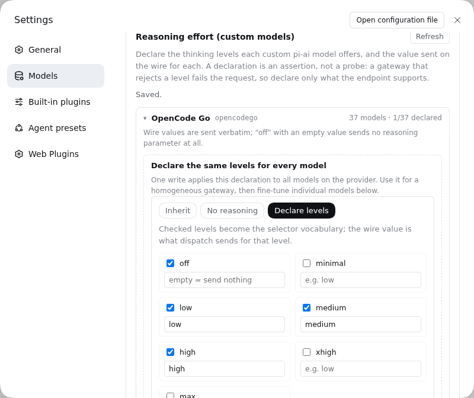

# dsh-model-reasoning-effort

[](https://github.com/pwkazn/dsh-model-reasoning-effort/actions/workflows/test.yml)
[](https://github.com/pwkazn/dsh-model-reasoning-effort/blob/main/LICENSE)

English | [中文](README.md)

Declare reasoning efforts (thinking levels and their wire values) for **custom pi-ai models** in DeepSeek Harness.

The official Models settings page deliberately leaves `reasoningEfforts` out of its provider editor: effort is a per-model capability, so a provider-scoped control could only be set to a value some models reject. The pi-ai adapter fully supports `reasoningEfforts` on every `models[]` entry; this plugin puts that field's editor back into the Web GUI.



## Features

- **Models-page footer panel** — registers the `settings.models.footer` list seat, not the `settings.models.provider-card` keyed seat, so it composes with other provider-card extensions such as `dsh-provider-headers`.
- **Three states per model**:
  - `Inherit` — declare nothing and keep the installed catalog / provider capability;
  - `No reasoning` — write `reasoningEfforts: false`, so selectors offer no thinking levels for that model;
  - `Declare levels` — check `off` / `minimal` / `low` / `medium` / `high` / `xhigh` / `max` and fill the value sent on the wire for each.
- **Level → wire mapping** — e.g. `high` mapped to `ultra`; an empty `off` value means “supported, send no reasoning parameter”.
- **Batch apply** — write one declaration to every model on a provider, for homogeneous gateways.
- **Validation before write** — mirrors the adapter: a declaration must offer a level beyond `off`, and every such level needs a non-empty wire value. The panel explains why a draft would be rejected instead of letting the Host refuse it later.
- **Official write path** — one `settings.mutate` call replaces the provider's complete `models` array, preserving fields this panel does not edit (id, name, context window, input modalities, compat, …) and carrying the settings revision to refuse a stale overwrite.
- **Layered read** — the editor prefers the authored user/base layer over the schema-resolved value, so the first save does not bake materialized defaults (`input: []`, empty `compat`) into the profile.
- **Chinese and English copy**, following the interface language.

## Install

From GitHub (no build step; plain ESM plus a hand-written client bundle):

```bash
dsh plugin --profile web add git+https://github.com/pwkazn/dsh-model-reasoning-effort.git
```

Link a development checkout:

```bash
dsh plugin --profile web add link:/path/to/dsh-model-reasoning
```

Open **Settings → Models**. The panel appears at the bottom of the page.

## Usage

1. Configure a custom model provider on the official Models page (an OpenAI-compatible / Anthropic Messages gateway, a self-hosted server, …).
2. Expand that provider in the panel.
3. Click **Edit** on a model, choose **Declare levels**, check the levels it supports, and fill each wire value. Or use the batch section to apply one declaration to all models.
4. Save. The composer's model selector now offers those efforts for the model.

> A declaration is an assertion, not a probe. A gateway that rejects a level fails the request at runtime; declare only what the endpoint documents.

## Design notes

- The panel edits only the user-writable `llm-pi-ai.providers.<route>.models` path. Routes that serve the installed pi-ai catalog directly (no `models` array) cannot be enumerated from the browser; the panel lists them with a hint to add model rows first.
- The first save materializes the provider's effective model list in the user settings layer — the same behavior as the official model editor when it first overrides an inherited catalog. Later composition-layer changes do not pass through that override.
- The DeepSeek direct adapter (`llm-deepseek`) is untouched: its efforts are deployment policy plus `reasoningEffort`, already exposed by the official settings.

## Development

```bash
npm test   # pure logic: three-state projection, validation, array writes, layered reads
```

## Files

| File | Role |
|---|---|
| `index.js` | Host half: a stateless placeholder so the Loader entry and client module graph exist |
| `client.js` | Browser half: the Models footer panel, effort editor, and settings writes |
| `cordis.patch.yml` | Bundle patch: inserts the Loader entry into the profile |
