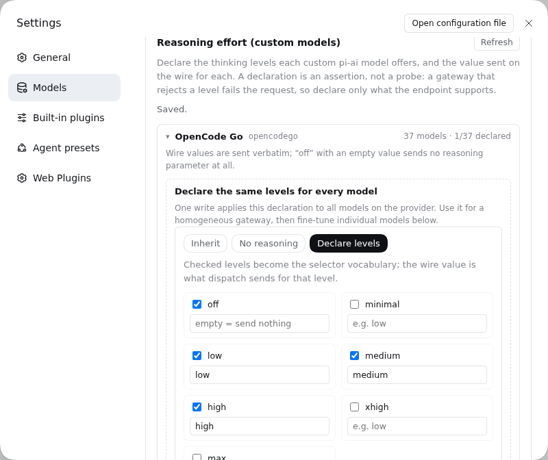

# dsh-model-reasoning-effort

为 DeepSeek Harness 的 **自定义 pi-ai 模型**声明推理强度（思考档位）的插件。



官方「模型」设置页刻意不提供 `reasoningEfforts` 编辑：推理强度是逐模型能力，提供方级的控件只能写成某个模型会拒绝的值。pi-ai 适配器本身完全支持 `models[]` 里的 `reasoningEfforts`，这个插件只是把这个字段的编辑器补回 Web GUI。

## 功能

- **Models 页底部面板**：注册 `settings.models.footer` 列表插槽（不抢占 `settings.models.provider-card` 的 `llm-pi-ai` 键位，因此可与其他提供方卡片扩展共存）。
- **逐模型三态**：
  - `继承`：不声明，保留内置目录 / 提供方的能力；
  - `无推理`：写入 `reasoningEfforts: false`，模型选择器不再提供思考档位；
  - `声明档位`：勾选 `off` / `minimal` / `low` / `medium` / `high` / `xhigh` / `max`，并为每一档填写实际发送值。
- **档位 → 发送值映射**：例如 `high` 填 `ultra`，Composer 选 High 时网关收到 `ultra`；`off` 留空表示“支持，但不发送推理参数”。
- **批量应用**：一次把同一组档位写入某提供方的全部模型，适合档位一致的中转网关。
- **写入前校验**：与适配器一致的规则（声明必须含 `off` 以外的档位；非 `off` 档位必须有非空发送值），直接说明草稿为什么会被拒绝。
- **官方线路写入**：通过 `settings.mutate` 替换该提供方的完整 `models` 数组，保留本插件不编辑的字段（id、名称、上下文窗口、输入模态、compat 等），并携带 revision 防止并发覆盖。
- **中英双语**，随界面语言切换。

## 安装

开发目录直接链接进 web profile：

```bash
dsh plugin --profile web add link:/home/admin/dsh-model-reasoning
```

或复制到 profile 的 `node_modules` 再由插件管理器选中（不推荐，容易在下次安装时丢失）。重启/热重载后，打开 **设置 → 模型**，页面底部出现「推理强度（自定义模型）」。

## 使用

1. 先在官方「模型」页配置自定义模型提供方（OpenAI 兼容 / Anthropic Messages 中转等）。
2. 在底部面板展开该提供方。
3. 点某个模型的「编辑」，选择「声明档位」，勾选需要的档位并填写发送值；或使用批量区一次性应用到全部模型。
4. 保存后在 Composer 的模型选择器里即可看到该模型的 Effort 档位。

> 声明是断言，不是探测。网关不接受某个档位时请求会在运行时失败；请以端点文档为准，只声明它确实支持的档位。

## 设计说明

- 面板只编辑用户设置层可写的 `llm-pi-ai.providers.<route>.models`。路线若直接服务内置 pi-ai 目录（没有 `models` 数组），浏览器侧无法枚举目录，面板会列出这些路线并提示先添加模型行。
- 首次保存会把该提供方的有效模型列表整体写入用户层 —— 与官方模型编辑器首次物化目录时的行为一致。之后组合层的改动不会自动穿透这层覆盖。
- 不触碰 DeepSeek 直连适配器（`llm-deepseek`）：它的档位由部署策略与 `reasoningEffort` 决定，已存在于官方设置中。

## 开发

```sh
npm test   # 纯逻辑校验：三态投影、发送值校验、整表写入、分层读取
```

## 文件

| 文件 | 作用 |
|---|---|
| `index.js` | Host 半：无状态占位，使 Loader 条目与客户端模块图成立 |
| `client.js` | 浏览器半：Models 页底部面板、档位编辑器与 settings 写入 |
| `cordis.patch.yml` | bundle 插层：把 Loader 条目插入 profile |
